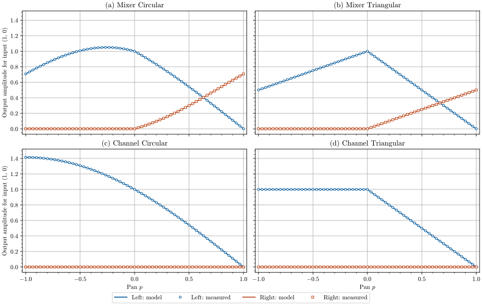
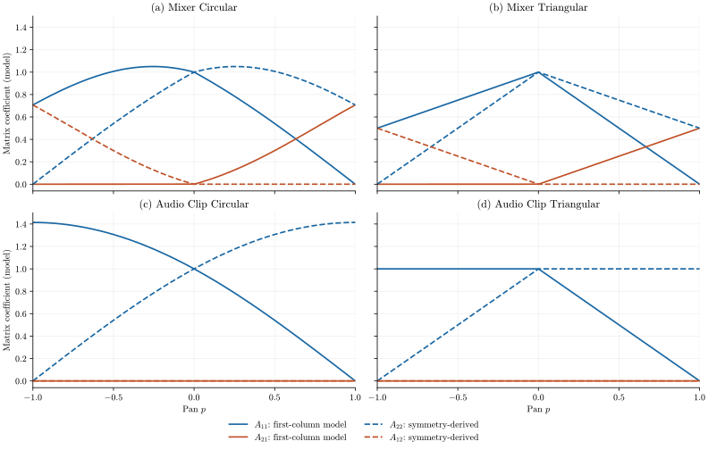
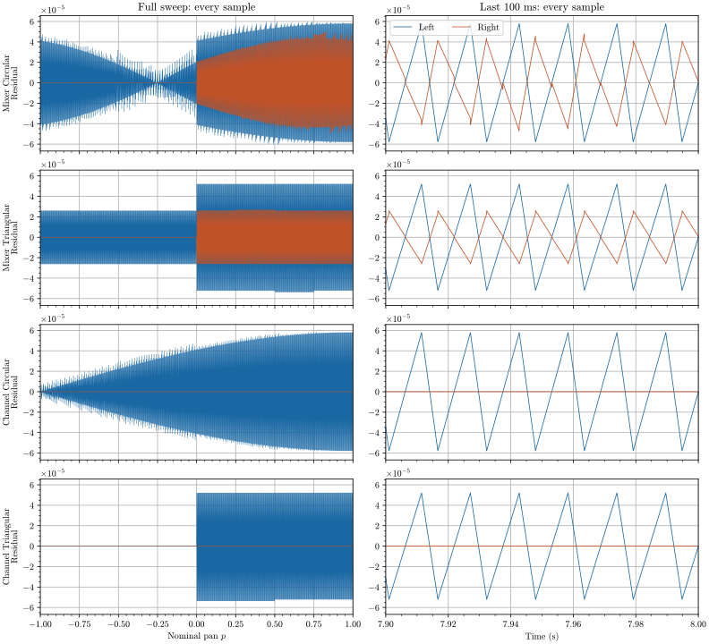
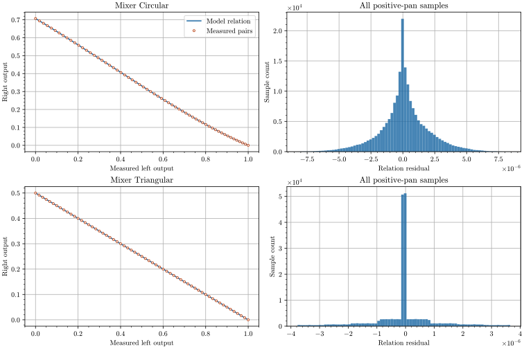
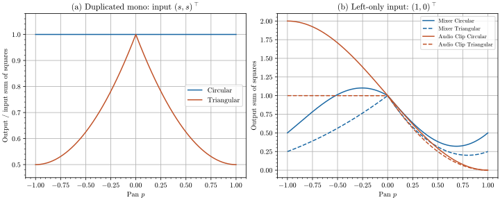
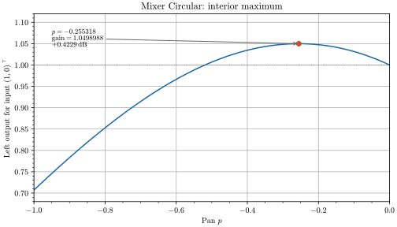

# FL Studio Panning Law

> The code and experimental data for this paper are available at [BiologyHazard/fl-studio-panning-law](https://github.com/BiologyHazard/fl-studio-panning-law).

## Summary of Results

The following results apply to FL Studio 20.8.3.2304.

Let $p\in[-1,1]$ be the pan position, where $-1$, $0$ and $1$ denote hard left, center and hard right; let $x_{\text{L}},x_{\text{R}}$ be the levels of the left and right channels of the input audio, and $y_{\text{L}},y_{\text{R}}$ the levels of the left and right channels of the output audio after panning. The pan transform is represented by the gain matrix $A(p)$:

$$
\begin{pmatrix}y_{\text{L}}\\y_{\text{R}}\end{pmatrix}
=A(p)\begin{pmatrix}x_{\text{L}}\\x_{\text{R}}\end{pmatrix}.
$$

In the project settings, the Panning law can be set to Circular or Triangular (Fig. 1), and the two laws correspond to different gain matrices. Whether panning is applied on the Mixer or on a Channel also changes the rule (Figs. 3 and 4). The gain matrix therefore falls into 4 cases: Mixer × Circular, Channel × Circular, Mixer × Triangular, and Channel × Triangular. The gain matrix formulas for the 4 cases follow.

### Circular

With the Panning law set to Circular, let $\theta=\pi(p+1)/4$ and define the auxiliary gains

$$
u_{\text{Circ}}(p)=\sqrt2\cos\theta,\qquad
v_{\text{Circ}}(p)=\sqrt2\sin\theta.
$$

**Mixer × Circular**

$$
A_{\text{Mixer,Circ}}(p)=
\begin{cases}
\begin{pmatrix}
u_{\text{Circ}}(1+v_{\text{Circ}})/2&
u_{\text{Circ}}(1-v_{\text{Circ}})/2\\
0&v_{\text{Circ}}
\end{pmatrix},&-1\le p\le0,\\[10pt]
\begin{pmatrix}
u_{\text{Circ}}&0\\
v_{\text{Circ}}(1-u_{\text{Circ}})/2&
v_{\text{Circ}}(1+u_{\text{Circ}})/2
\end{pmatrix},&0<p\le1.
\end{cases}
$$

**Channel × Circular**

$$
A_{\text{Channel,Circ}}(p)=
\begin{pmatrix}
u_{\text{Circ}}&0\\
0&v_{\text{Circ}}
\end{pmatrix},
\qquad -1\le p\le1.
$$

### Triangular

With the Panning law set to Triangular, define the auxiliary gains

$$
u_{\text{Tri}}(p)=1-\max(p,0),\qquad
v_{\text{Tri}}(p)=1+\min(p,0).
$$

**Mixer × Triangular**

$$
A_{\text{Mixer,Tri}}(p)=
\begin{cases}
\begin{pmatrix}
1+p/2&-p/2\\
0&1+p
\end{pmatrix},&-1\le p\le0,\\[10pt]
\begin{pmatrix}
1-p&0\\
p/2&1-p/2
\end{pmatrix},&0<p\le1.
\end{cases}
$$

**Channel × Triangular**

$$
A_{\text{Channel,Tri}}(p)=
\begin{pmatrix}
u_{\text{Tri}}&0\\
0&v_{\text{Tri}}
\end{pmatrix},
\qquad -1\le p\le1.
$$

## Abstract

The official FL Studio documentation describes the level-compensation characteristics of Circular and Triangular and the channel-mixing behavior of the Mixer, but it gives no complete pan transform. This study uses a unit DC signal in the left channel as input and sweeps Mixer and Channel panning linearly from hard left to hard right in FL Studio 20.8.3.2304, identifying the gain matrices of the 4 cases by analyzing the exported two-channel audio. The results show that the Mixer mixes one side into the panned side, whereas the Channel adjusts the left and right gains independently; both panning laws admit a unified representation through distinct auxiliary gain functions. The per-sample maximum absolute residual between the analytic formulas and the exported audio is below $6.1\times10^{-5}$, and the residual of the Mixer output relation after eliminating the pan parameter is below $8.5\times10^{-6}$. The formulas account for the equal-power property of Circular under in-phase, equal-amplitude stereo input, as well as the internal amplitude peak of about $+0.423\,\text{dB}$ that Mixer Circular produces for single-sided input.

## 1. Introduction

### 1.1 Panning laws

A pan knob looks as if it merely moves the sound to one side, but it also changes the left and right output levels. Take a mono signal: at hard left only the left channel outputs; at center both channels output it. If both sides kept the original amplitude, the total stereo power, and the level after summing to mono, would change. **The panning law specifies exactly how the left and right gains vary with pan position.**

Taking the active-channel gain at the extreme position as $1$, there are two typical choices for the mono case:

- **Preserve total stereo power:** the squares of the left and right gains sum to $1$. At center each gain is $1/\sqrt2$, about $3\,\text{dB}$ below the endpoint. This is the common equal-power panning law, but summing the two outputs directly still leaves the center about $3\,\text{dB}$ above the endpoint.

- **Preserve mono-sum level:** the left and right gains sum to $1$. At center each gain is $1/2$, about $6\,\text{dB}$ below the endpoint. The summed signal amplitude then stays constant with pan, but the total stereo power at center is about $3\,\text{dB}$ below the endpoint.

This is the background of the common $-3\,\text{dB}$, $-6\,\text{dB}$ and compromise $-4.5\,\text{dB}$ center attenuation values. They serve different level goals, and no single choice fits every scenario.

Center attenuation, however, describes only one position; it cannot uniquely determine the whole gain curve from hard left to hard right. Different curves can share the same center and endpoint gains yet produce different level changes in between. Knowing that a setting is “3 dB down at center relative to the extremes” is therefore not enough to compute the output at an arbitrary position.

Stereo input, which already has two channels, raises an additional question: does the knob only change the gain of each channel, or does it mix one side into the other? The first case may erase the other side's content at full pan; the second may preserve it. When mixing occurs, the output level also depends on the correlation and phase of the two input signals. A mono panning curve alone cannot describe the stereo case.

This paper takes FL Studio as an example and examines how the Mixer and Channel pan controls handle left and right inputs under the Circular and Triangular settings. What must be determined is not just a compensation level in decibels, but the same-side gain and the cross-channel mixing relation across the entire pan range. We first review the official documentation, then define the scope of the study.

### 1.2 What the official documentation says about panning laws

In the “Panning law” entry of *Project General Settings*, the FL Studio manual states that the panning law compensates the apparent loudness change as a sound moves from center to the sides. It describes the two settings as follows [1]:

> “Circular - Level compensation is applied when panning (orange). Level drops 3 dB at center pan.”

That is, Circular applies level compensation as the pan changes, and the level at center is about $3\,\text{dB}$ below the extreme positions.

> “Triangular - No level compensation is used as a function of pan position (green).”

That is, Triangular applies no such level compensation as a function of pan position. The entry also notes that its overall level is about $3\,\text{dB}$ below the Circular hard-pan position.

The manual then describes the level reference of an audio clip under the default channel setting [1]:

> “in this case volume is being added at extremes instead of subtracted at the center position.”

That is, here the compensation appears as a level increase at the two ends. In context: under the default Channel Sampler setting, the level readout of the audio clip equals the recorded level, and with Circular the level can rise by up to about $3\,\text{dB}$. The relative difference between center and the ends must therefore be understood together with the level reference of the actual signal path.

On the Mixer pan control, the *Mixer* page states [2]:

> “The pan works by mixing one side of the stereo track into the other, so a 100% pan is the mono-sum of the Left and Right channels.”

These statements give the purpose of the pan control, the compensation magnitude, and the Mixer's mixing behavior, but they **give neither the specific formula for gain versus pan position nor the complete expression for the cross-mixing coefficients of the two channels**. From the center and endpoint level relations alone, many continuous functions still qualify. Determining the output at an arbitrary pan position therefore requires empirical identification of the transform.

### 1.3 Scope

This study compares the following 4 combinations:

| Control location           | Circular         | Triangular         |
| -------------------------- | ---------------- | ------------------ |
| Mixer panning              | Mixer Circular   | Mixer Triangular   |
| Audio Clip channel panning | Channel Circular | Channel Triangular |

The experiments use FL Studio 20.8.3.2304 and address two questions: how the two types of pan control transform left and right inputs, and how the Circular / Triangular setting alters that transform.

**Figure 1. Project panning law setting.** The “Panning law” drop-down offers Circular and Triangular, which form one control factor of this experiment.

## 2. Notation, Assumptions and Measurement Principle

### 2.1 Input, output and pan parameter

Two-channel audio consists of frames arranged in time, each frame containing one left-channel and one right-channel sample. This paper uses the following notation:

| Symbol                                | Definition                                                                                                                                                                      |
| ------------------------------------- | ------------------------------------------------------------------------------------------------------------------------------------------------------------------------------- |
| $n$                                   | Sample frame index starting from $0$, $n=0,\ldots,N-1$                                                                                                                          |
| $T$                                   | Total audio duration; $T=8\,\text{s}$ in this paper                                                                                                                             |
| $f_s$                                 | Sampling rate; $f_s=48000\,\text{Hz}$ in this paper                                                                                                                             |
| $N = f_s \cdot T$                     | Total number of frames; $N=384000$ in this paper                                                                                                                                |
| $t_n=n/f_s$                           | Time corresponding to frame $n$                                                                                                                                                 |
| $x_{\text{L}}[n],x_{\text{R}}[n]$     | Left and right sample values of frame $n$ of the input audio                                                                                                                    |
| $y_{\text{L}}[n],y_{\text{R}}[n]$     | Left and right sample values of frame $n$ of the output audio                                                                                                                   |
| $\boldsymbol{x}[n],\boldsymbol{y}[n]$ | Column vectors, $\boldsymbol{x}[n]=\begin{pmatrix}x_{\text{L}}[n]\\x_{\text{R}}[n]\end{pmatrix},\boldsymbol{y}[n]=\begin{pmatrix}y_{\text{L}}[n]\\y_{\text{R}}[n]\end{pmatrix}$ |
| $p$                                   | Normalized pan position; $-1$ is hard left, $0$ is center, $1$ is hard right                                                                                                    |
| $p[n]$                                | Pan position of frame $n$                                                                                                                                                       |
| $A(p)$                                | $2\times2$ gain matrix at pan position $p$                                                                                                                                      |
| $A_{ij}(p)$                           | Gain from input channel $j$ to output channel $i$                                                                                                                               |

### 2.2 Model assumptions

This study adopts 3 assumptions about the pan transform:

1. **Memorylessness:** at a given pan position, the output of each frame depends only on the left and right inputs of that frame.
2. **Linearity:** at a given pan position, the output is a linear combination of the inputs.
3. **Left-right symmetry:** swapping both the input and output channels while reversing the pan direction leaves the transform unchanged.

The first 2 assumptions let the pan transform be written as

$$
\boldsymbol{y}[n]=A(p[n])\boldsymbol{x}[n],
\qquad
A(p)=
\begin{pmatrix}
A_{\text{LL}}(p)&A_{\text{LR}}(p)\\
A_{\text{RL}}(p)&A_{\text{RR}}(p)
\end{pmatrix}.
$$

Expanding by channel gives

$$
\begin{aligned}
y_{\text{L}}[n]&=A_{\text{LL}}(p[n])x_{\text{L}}[n]+A_{\text{LR}}(p[n])x_{\text{R}}[n],\\
y_{\text{R}}[n]&=A_{\text{RL}}(p[n])x_{\text{L}}[n]+A_{\text{RR}}(p[n])x_{\text{R}}[n].
\end{aligned}
$$

The diagonal elements thus describe the same-side gains and the off-diagonal elements the cross-channel mixing. Linearity applies to the audio input; the matrix coefficients may vary nonlinearly with the pan parameter $p$.

Let the exchange matrix $J$ be

$$
J=\begin{pmatrix}0&1\\1&0\end{pmatrix},
$$

so that the third assumption reads

$$
A(-p)=J A(p)J.
$$

### 2.3 Left-channel DC excitation and matrix reconstruction

The experiment uses a constant DC input $x_{\text{L}}[n]=1$, $x_{\text{R}}[n]=0$. Substituting this input gives

$$
y_{\text{L}}[n]=A_{\text{LL}}(p[n]),\qquad y_{\text{R}}[n]=A_{\text{RL}}(p[n]).
$$

In other words, the output samples directly give the two gain coefficients in the first column of the matrix. To describe the measurements, define $f(p)=A_{\text{LL}}(p)$ and $h(p)=A_{\text{RL}}(p)$, the gains from the left input to the left output and to the right output, respectively. Using left-right symmetry, the matrix can be reconstructed as

$$
A(p)=
\begin{pmatrix}
f(p)&h(-p)\\
h(p)&f(-p)
\end{pmatrix}.
\tag{1}
$$

Sweeping the same left-channel DC signal from hard left to hard right thus yields everything needed for the complete two-channel transform.

## 3. Experimental Design

### 3.1 Input audio

The input is a two-channel DC signal: the left channel equals $1$ on all frames and the right channel equals $0$. Fig. 2 shows the waveform in the audio editor.

**Figure 2. Input test signal.** The upper left channel holds a unit positive amplitude and the lower right channel stays at zero. The scale on the right is the dB display; the red horizontal line marks the zero-amplitude reference.

In the Mixer condition, automation drives the Panning control of the Master track; the automation clip is labeled “Master - Panning” in Fig. 3. In the Channel condition, automation drives the channel pan knob in the Channel Rack; the clip is labeled “Left Channel DC - Channel panning” in Fig. 4.

**Figure 3. Mixer control location.** The automation targets the pan knob of the Master mixer channel.

**Figure 4. Channel control location.** The automation targets the pan knob of the “Left Channel DC” channel in the Channel Rack.

### 3.2 Render settings and pan sweep

| Item                      | Setting or value                               |
| ------------------------- | ---------------------------------------------- |
| Input, output format      | Two-channel WAV, IEEE 754 float32              |
| Sampling rate $f_s$       | 48000 Hz                                       |
| Number of frames $N$      | 384000                                         |
| Duration $T=N/f_s$        | 8 s                                            |
| Pan sweep                 | Linear automation from hard left to hard right |
| Experimental combinations | Two control locations × two panning laws       |
| Output files              | One per combination, 4 in total                |

Each combination is rendered into one two-channel audio file, keeping the floating-point amplitudes of the output samples for per-sample computation of the gain coefficients and residuals.

Export uses the settings shown in Fig. 5. WAV, 32Bit float and Stereo are selected to preserve the two-channel floating-point amplitudes; Full song with Tail set to Cut remainder makes the output length match the 8 s sweep interval.

**Figure 5. Audio export settings.** Export uses Full song and Cut remainder, producing a two-channel 32-bit float WAV.

To convert a sample index into a pan coordinate, define the **nominal pan position** of frame $n$ as $\bar p_n$:

$$
\bar p_n=-1+\frac{2t_n}{T}
=-1+\frac{2n}{N},\qquad n=0,\ldots,N-1.
$$

The overbar denotes the parameter value specified by the experimental time axis. $n=192000$ corresponds to center; the last frame corresponds to $\bar p_{N-1}=1-2/N\approx0.999994792$. The hard-right position $p=1$ corresponds to $t=T=8\,\text{s}$, whereas the last frame lies at $t_{N-1}=T-1/f_s$, so the audio samples do not include the hard-right position.

## 4. Identifying the Panning Laws and Measured Responses

Starting from the measured response to unit left-channel input, this chapter identifies the complete transform matrix of each of the 4 cases. Again let $f(p)$ be the gain from the left input to the left output and $h(p)$ the gain from the left input to the right output; for the input $(1,0)^\top$ these two curves are the measured left and right outputs. Under the model assumptions of Section 2.2, the left-right exchange relation completes the other column of the matrix according to Eq. (1).

Each subsection first presents the measured waveform and response functions, then expresses the matrix structure in terms of the auxiliary gains, then gives the explicit form in the pan parameter $p$ alone, and explains its action on left and right inputs. The Circular auxiliary gains are written $u_{\text{Circ}}(p),v_{\text{Circ}}(p)$ and the Triangular ones $u_{\text{Tri}}(p),v_{\text{Tri}}(p)$; the argument $p$ is omitted in the formulas. In each subsection, $A_{\text{LL}},A_{\text{LR}},A_{\text{RL}},A_{\text{RR}}$ refer to the elements of that subsection's matrix.

### 4.1 Mixer × Circular

**Figure 6. Output waveform of Mixer Circular.** The left output first rises and then falls to $0$, running slightly above unit amplitude before center; the right output increases from the midpoint of the sweep onward, reaching about $-3\,\text{dB}$ near hard right.

To describe this response, define the Circular auxiliary gains

$$
\theta=\frac{\pi(p+1)}4,\qquad
u_{\text{Circ}}(p)=\sqrt2\cos\theta,\qquad
v_{\text{Circ}}(p)=\sqrt2\sin\theta.
$$

Here $\theta$ maps the range from hard left to hard right onto $[0,\pi/2]$. The two gain functions satisfy $v_{\text{Circ}}(p)=u_{\text{Circ}}(-p)$ and $u_{\text{Circ}}^2+v_{\text{Circ}}^2=2$, and both equal $1$ at center.

For unit left input, the measured response is described by the piecewise functions

$$
\begin{aligned}
f(p)&=
\begin{cases}
u_{\text{Circ}}(1+v_{\text{Circ}})/2,&-1\le p\le0,\\
u_{\text{Circ}},&0<p\le1,
\end{cases}\\[10pt]
h(p)&=
\begin{cases}
0,&-1\le p\le0,\\
v_{\text{Circ}}(1-u_{\text{Circ}})/2,&0<p\le1.
\end{cases}
\end{aligned}
$$

The right output is $0$ in the left-pan region; in the right-pan region it grows as the left channel attenuates. Substituting these two functions into the left-right exchange relation gives the complete matrix

$$
\begin{aligned}
A_{\text{Mixer,Circ}}(p)=
\begin{cases}
\begin{pmatrix}
u_{\text{Circ}}(1+v_{\text{Circ}})/2&
u_{\text{Circ}}(1-v_{\text{Circ}})/2\\
0&v_{\text{Circ}}
\end{pmatrix},&-1\le p\le0,\\[10pt]
\begin{pmatrix}
u_{\text{Circ}}&0\\
v_{\text{Circ}}(1-u_{\text{Circ}})/2&
v_{\text{Circ}}(1+u_{\text{Circ}})/2
\end{pmatrix},&0<p\le1.
\end{cases}
\end{aligned}
\tag{2}
$$

Without auxiliary variables, the form containing only $p$ is

$$
A_{\text{LL}}(p)=
\begin{cases}
\frac{1}{\sqrt2}\cos\!\left(\frac{\pi(p+1)}4\right)
\left(1+\sqrt2\sin\!\left(\frac{\pi(p+1)}4\right)\right),&-1\le p\le0,\\[6pt]
\sqrt2\cos\!\left(\frac{\pi(p+1)}4\right),&0<p\le1.
\end{cases}
$$

$$
A_{\text{LR}}(p)=
\begin{cases}
\frac{1}{\sqrt2}\cos\!\left(\frac{\pi(p+1)}4\right)
\left(1-\sqrt2\sin\!\left(\frac{\pi(p+1)}4\right)\right),&-1\le p\le0,\\[6pt]
0,&0<p\le1.
\end{cases}
$$

$$
A_{\text{RL}}(p)=
\begin{cases}
0,&-1\le p\le0,\\[6pt]
\frac{1}{\sqrt2}\sin\!\left(\frac{\pi(p+1)}4\right)
\left(1-\sqrt2\cos\!\left(\frac{\pi(p+1)}4\right)\right),&0<p\le1.
\end{cases}
$$

$$
A_{\text{RR}}(p)=
\begin{cases}
\sqrt2\sin\!\left(\frac{\pi(p+1)}4\right),&-1\le p\le0,\\[6pt]
\frac{1}{\sqrt2}\sin\!\left(\frac{\pi(p+1)}4\right)
\left(1+\sqrt2\cos\!\left(\frac{\pi(p+1)}4\right)\right),&0<p\le1.
\end{cases}
$$

These 4 coefficients describe the same-side gains and the cross mixing at once. To see the mixing ratio, take the left-pan region and write the output as

$$
\begin{aligned}
y_{\text{L}}&=
u_{\text{Circ}}\left(
\frac{1+v_{\text{Circ}}}{2}x_{\text{L}}
+\frac{1-v_{\text{Circ}}}{2}x_{\text{R}}
\right),\\
y_{\text{R}}&=v_{\text{Circ}}x_{\text{R}}.
\end{aligned}
$$

The two weights inside the left-output brackets sum to $1$: at center $v_{\text{Circ}}=1$ and the weights are $(1,0)$; at hard left $v_{\text{Circ}}=0$ and the weights are $(1/2,1/2)$. Meanwhile the outer gain $u_{\text{Circ}}$ rises from $1$ to $\sqrt2$. Panning thus changes both the mixing ratio of the left and right inputs and the gain applied after mixing. For the single-sided input of this experiment, these two changes together produce the internal amplitude peak in the left-pan region, whose position and magnitude are derived in Section 6.3.

### 4.2 Mixer × Triangular

**Figure 7. Output waveform of Mixer Triangular.** The left output rises linearly from about $-6\,\text{dB}$ to $0\,\text{dB}$ at center, then falls linearly to $0$; the right output is $0$ in the left-pan region and rises linearly to about $-6\,\text{dB}$ in the right-pan region.

The Triangular auxiliary gains are

$$
u_{\text{Tri}}(p)=1-\max(p,0),\qquad
v_{\text{Tri}}(p)=1+\min(p,0).
$$

In the left-pan region $u_{\text{Tri}}=1$ and $v_{\text{Tri}}=1+p$; in the right-pan region $u_{\text{Tri}}=1-p$ and $v_{\text{Tri}}=1$. For unit left input, the measured response corresponds to

$$
f(p)=
\begin{cases}
1+p/2,&-1\le p\le0,\\
1-p,&0<p\le1,
\end{cases}
\qquad
h(p)=
\begin{cases}
0,&-1\le p\le0,\\
p/2,&0<p\le1.
\end{cases}
$$

Writing these expressions in auxiliary-gain form and completing the matrix gives

$$
\begin{aligned}
A_{\text{Mixer,Tri}}(p)&=
\begin{cases}
\begin{pmatrix}
u_{\text{Tri}}(1+v_{\text{Tri}})/2&
u_{\text{Tri}}(1-v_{\text{Tri}})/2\\
0&v_{\text{Tri}}
\end{pmatrix},&-1\le p\le0,\\[10pt]
\begin{pmatrix}
u_{\text{Tri}}&0\\
v_{\text{Tri}}(1-u_{\text{Tri}})/2&
v_{\text{Tri}}(1+u_{\text{Tri}})/2
\end{pmatrix},&0<p\le1.
\end{cases}\\[12pt]
&=
\begin{cases}
\begin{pmatrix}
1+p/2&-p/2\\
0&1+p
\end{pmatrix},&-1\le p\le0,\\[10pt]
\begin{pmatrix}
1-p&0\\
p/2&1-p/2
\end{pmatrix},&0<p\le1.
\end{cases}
\end{aligned} \tag{3}
$$

Eq. (3) shares the mixing structure of Mixer Circular, but every coefficient is piecewise linear. For unit left input, the left output rises from $1/2$ at hard left to $1$ at center in the left-pan region; in the right-pan region the left output falls to zero as the right output rises to $1/2$. For general two-channel input, the right input mixes into the left output through $-p/2$ while panning left, and the left input mixes into the right output through $p/2$ while panning right. At both extremes the active channel outputs $(x_{\text{L}}+x_{\text{R}})/2$, unlike the endpoint gain of Circular.

### 4.3 Channel × Circular

**Figure 8. Output waveform of Channel Circular.** The left output decreases gradually from about $+3\,\text{dB}$ to $0$, and the right output stays at $0$.

Using the Circular auxiliary gains defined in Section 4.1: in this experiment the right output is numerically zero on all frames and the left output corresponds to $u_{\text{Circ}}(p)$. The two responses identified from the left-channel excitation are therefore

$$
f(p)=u_{\text{Circ}}(p),\qquad h(p)=0.
$$

Since $u_{\text{Circ}}(-p)=v_{\text{Circ}}(p)$, the complete matrix is

$$
\begin{aligned}
A_{\text{Channel,Circ}}(p)&=
\begin{pmatrix}
u_{\text{Circ}}&0\\
0&v_{\text{Circ}}
\end{pmatrix}\\[12pt]
&=
\begin{pmatrix}
\sqrt2\cos\!\left(\frac{\pi(p+1)}4\right)&0\\[6pt]
0&\sqrt2\sin\!\left(\frac{\pi(p+1)}4\right)
\end{pmatrix},
\qquad -1\le p\le1.
\end{aligned} \tag{4}
$$

The matrix is diagonal, i.e. $y_{\text{L}}=u_{\text{Circ}}x_{\text{L}}$ and $y_{\text{R}}=v_{\text{Circ}}x_{\text{R}}$: the left and right inputs are gain-adjusted independently, with no cross mixing. A left-channel input gains a factor of $\sqrt2$ at hard left, unit gain at center, and drops to zero at hard right; the right channel varies in mirror symmetry. Compared with Mixer Circular, the Channel uses the Circular auxiliary gains directly as its same-side gains, so the left input of this experiment never appears in the right output.

### 4.4 Channel × Triangular

**Figure 9. Output waveform of Channel Triangular.** The left output stays at $0\,\text{dB}$ throughout the left-pan region and falls linearly to $0$ in the second half; the right output stays at $0$.

Using the Triangular auxiliary gains defined in Section 4.2: the measured left output holds unit amplitude over the left half and falls linearly over the right half, while the right output is numerically zero on all frames. The two responses identified from the left-channel excitation are therefore

$$
f(p)=u_{\text{Tri}}(p),\qquad h(p)=0.
$$

Using $u_{\text{Tri}}(-p)=v_{\text{Tri}}(p)$ gives

$$
\begin{aligned}
A_{\text{Channel,Tri}}(p)&=
\begin{pmatrix}
u_{\text{Tri}}&0\\
0&v_{\text{Tri}}
\end{pmatrix}\\[12pt]
&=
\begin{cases}
\begin{pmatrix}
1&0\\
0&1+p
\end{pmatrix},&-1\le p\le0,\\[10pt]
\begin{pmatrix}
1-p&0\\
0&1
\end{pmatrix},&0<p\le1.
\end{cases}
\end{aligned} \tag{5}
$$

Hence while panning left the output is $y_{\text{L}}=x_{\text{L}}$, $y_{\text{R}}=(1+p)x_{\text{R}}$; while panning right it is $y_{\text{L}}=(1-p)x_{\text{L}}$, $y_{\text{R}}=x_{\text{R}}$. The panned side keeps unit gain and the other side attenuates linearly with pan position. Compared with Channel Circular, the diagonal structure is unchanged but the trigonometric gains give way to piecewise-linear gains; compared with Mixer Triangular, there is no cross term mixing the other side's input into the panned side.

### 4.5 Comparing responses and summarizing structure

The preceding sections give two ways of writing the same transform: the auxiliary-gain form, convenient for comparing structure, and the explicit $p$-only form, convenient for direct computation. Eqs. (2) and (3) share the same piecewise mixing structure; Eqs. (4) and (5) share the same diagonal structure. Circular and Triangular use trigonometric and piecewise-linear gains respectively. These two aspects are now compared together with the measured responses.

**Figure 10. Output response to unit left-channel input.** Blue and orange denote the left and right outputs; solid lines are the results of Eqs. (2)–(5) and open symbols are uniformly sampled measured points. The horizontal axis is the nominal pan position. The raw output waveforms are shown in Figs. 6–9.

The right channel of both Channel outputs is numerically zero on all frames; the right channel of both Mixer outputs carries signal in the right half of the sweep. The core difference between the two controls is this: **Channel adjusts the two gains independently, whereas Mixer mixes the other side's input into the panned side.**

**Figure 11. The 4 coefficients of the complete matrix.** Solid lines are the first column identified by the left-channel excitation, dashed lines are the second column completed by Eq. (1). Blue denotes same-side gains, orange cross-mixing gains; some zero-coefficient curves coincide.

All 4 cases satisfy $A(0)=I$ at center, where $I$ is the $2\times2$ identity matrix, so at center the output equals the input channel by channel. The curves above show the overall correspondence between the formulas and the measured responses; the next chapter quantifies the difference further through per-sample residuals and the parameter-eliminated relation.

## 5. Error Analysis

### 5.1 Per-sample residuals over the full range

Raw float32 samples are converted to float64 for the computation. For output channel $c$ ($c=\text{L}$ or $\text{R}$), let $\hat y_c(p)$ be the output predicted by the formulas for unit left-channel input, and define the residual

$$
e_c[n]=y_c[n]-\hat y_c(\bar p_n).
$$

Consistency is measured by the maximum absolute residual $E_{\infty,c}$ and the residual root mean square $E_{\text{RMS},c}$:

$$
E_{\infty,c}=\max_n|e_c[n]|,\qquad
E_{\text{RMS},c}=
\sqrt{\frac1N\sum_{n=0}^{N-1}e_c[n]^2}.
$$

All $384000$ frames enter the statistics, with amplitudes referenced to the unit input amplitude.

The per-sample statistics are listed in Table 1.

| Condition          | Left output $E_\infty$ | Left output $E_{\text{RMS}}$ | Right output $E_\infty$ | Right output $E_{\text{RMS}}$ |
| ------------------ | ---------------------: | ---------------------------: | ----------------------: | ----------------------------: |
| Mixer Circular     |   $6.074\times10^{-5}$ |         $2.369\times10^{-5}$ |    $5.030\times10^{-5}$ |          $1.533\times10^{-5}$ |
| Mixer Triangular   |   $5.360\times10^{-5}$ |         $2.345\times10^{-5}$ |    $2.677\times10^{-5}$ |          $1.051\times10^{-5}$ |
| Channel Circular   |   $5.826\times10^{-5}$ |         $2.372\times10^{-5}$ |                     $0$ |                           $0$ |
| Channel Triangular |   $5.363\times10^{-5}$ |         $2.122\times10^{-5}$ |                     $0$ |                           $0$ |

**Table 1. Forward residuals of the 4 panning laws.**

**Figure 12. Per-sample residual $e_c[n]$ of the measured value minus the formula prediction.** The left column plots the residual of all $384000$ frames over the entire pan range; the right column shows all $4800$ frames of the last 100 ms ($7.9\le t<8.0\,\text{s}$). Both columns keep the sign and plot the residual as a connected per-sample line, without taking absolute values, binning, envelope extraction or downsampling. All panels share the same vertical range for direct comparison of residual magnitude; the scientific-notation factor beside the axis gives the scale of the tick marks. The right column shows the local time structure of the residuals.

### 5.2 Testing the output relation with the pan parameter eliminated

In the right-pan region of the Mixer, $p$ can be eliminated and the relation between the left and right outputs of the same frame tested directly. The test then uses only output amplitudes.

For Mixer Circular, Eq. (2) gives

$$
\hat y_{\text{R}}=
\frac{(1-y_{\text{L}})\sqrt{2-y_{\text{L}}^2}}2.
$$

For Mixer Triangular, Eq. (3) gives

$$
\hat y_{\text{R}}=\frac{1-y_{\text{L}}}{2}.
$$

Here $y_{\text{L}}$ is the measured left output of the same frame and $\hat y_{\text{R}}$ the right output predicted from it. With relation residual $r=y_{\text{R}}-\hat y_{\text{R}}$, over all $191999$ frames with nominal $p>0$:

| Condition        | Max absolute residual |                  RMS |
| ---------------- | --------------------: | -------------------: |
| Mixer Circular   |  $8.411\times10^{-6}$ | $1.906\times10^{-6}$ |
| Mixer Triangular |  $3.770\times10^{-6}$ | $1.064\times10^{-6}$ |

**Table 2. Residuals of the Mixer left-right output relation.**

**Figure 13. Output relation after eliminating the pan parameter.** The solid lines in the left column are the two relations above and open symbols are the measured outputs; the histograms in the right column contain the relation residuals of all right-pan samples.

The spacing of adjacent float32 numbers is $2^{-23}\approx1.192\times10^{-7}$ on $[1,2)$ and $2^{-24}\approx5.960\times10^{-8}$ on $[0.5,1)$. The residuals in Table 1 exceed the size of a single rounding step at unit amplitude; they reflect the combined effects of the sweep trajectory and the processing chain.

## 6. Properties of the Pan Transform

### 6.1 Outputs at extreme pan positions

Let $k$ denote the endpoint gain constant: $k=\sqrt2$ for Circular and $k=1$ for Triangular. At the endpoints the 4 cases reduce to

$$
A_{\text{Mixer}}(-1)=\frac{k}{2}
\begin{pmatrix}1&1\\0&0\end{pmatrix},
\qquad
A_{\text{Mixer}}(1)=\frac{k}{2}
\begin{pmatrix}0&0\\1&1\end{pmatrix},
\tag{6}
$$

$$
A_{\text{Channel}}(-1)=
\begin{pmatrix}k&0\\0&0\end{pmatrix},
\qquad
A_{\text{Channel}}(1)=
\begin{pmatrix}0&0\\0&k\end{pmatrix}.
$$

At full Mixer pan the panned side therefore outputs a weighted sum of the left and right inputs: $(x_{\text{L}}+x_{\text{R}})/\sqrt2$ for Circular and $(x_{\text{L}}+x_{\text{R}})/2$ for Triangular. This supplies the specific coefficient behind the official “mono-sum” description. At full Channel pan the panned side outputs $k$ times its own input.

For anti-phase input $(s,-s)^\top$, where $s$ is an arbitrary instantaneous sample value, the two inputs cancel in the Mixer sum at full pan, whereas the Channel retains the input component of the panned side.

| Condition          | Formula output at $p=-1$ | Measured first frame |
| ------------------ | ------------------------ | -------------------- |
| Mixer Circular     | $(0.707106781,0)$        | $(0.707106709,0)$    |
| Mixer Triangular   | $(0.5,0)$                | $(0.499999881,0)$    |
| Channel Circular   | $(1.414213562,0)$        | $(1.414212704,0)$    |
| Channel Triangular | $(1,0)$                  | $(0.999999821,0)$    |

**Table 3. Model output at the left endpoint $p=-1$ and the measured first frame $(y_{\text{L}},y_{\text{R}})$.**

| Condition          | Formula output at $p=1$ | Measured last frame                   |
| ------------------ | ----------------------- | ------------------------------------- |
| Mixer Circular     | $(0,0.707106781)$       | $(5.556781\times10^{-6},0.707104146)$ |
| Mixer Triangular   | $(0,0.5)$               | $(4.999208\times10^{-6},0.499998212)$ |
| Channel Circular   | $(0,0)$                 | $(5.554710\times10^{-6},0)$           |
| Channel Triangular | $(0,0)$                 | $(5.000166\times10^{-6},0)$           |

**Table 4. Model output at the right endpoint $p=1$ and the measured last frame $(y_{\text{L}},y_{\text{R}})$.**

The first measured frame has pan $p=-1$; the last frame has nominal position $p=1-2/N$, and the model values in the tables use the nominal right endpoint $p=1$. The two tables list the model values at the two ends and the measured boundary samples for comparison.

### 6.2 Power relation for in-phase stereo input

For identical left and right inputs $\boldsymbol{x}=(s,s)^\top$, both types of control give the same output under the same panning law. For Circular,

$$
\boldsymbol{y}=
\begin{pmatrix}
\sqrt2\cos\!\left(\dfrac{\pi(p+1)}4\right)s\\[10pt]
\sqrt2\sin\!\left(\dfrac{\pi(p+1)}4\right)s
\end{pmatrix};
$$

for Triangular,

$$
\boldsymbol{y}=
\begin{cases}
\begin{pmatrix}s\\(1+p)s\end{pmatrix},&-1\le p\le0,\\[10pt]
\begin{pmatrix}(1-p)s\\s\end{pmatrix},&0<p\le1.
\end{cases}
$$

Define the instantaneous two-channel sums of squares of the input and output as $Q_x=x_{\text{L}}^2+x_{\text{R}}^2$ and $Q_y=y_{\text{L}}^2+y_{\text{R}}^2$. Time-averaging these squared quantities gives the mean-square power of the corresponding digital signal. Circular satisfies

$$
Q_y=2s^2=Q_x,
$$

i.e. it preserves power for in-phase, equal-amplitude stereo input. Triangular gives

$$
\frac{Q_y}{Q_x}=
\frac{1+(1-|p|)^2}{2},\qquad s\ne0,
\tag{7}
$$

which falls from $1$ at center to $1/2$ at the extremes.

For single-sided input $(1,0)^\top$, the output sum of squares is $f(p)^2+h(p)^2$, which varies with pan position, as shown in Fig. 14(b). For general stereo input, the Mixer cross mixing also makes the output power depend on the correlation of the left and right inputs.

**Figure 14. Power relations computed from the pan formulas.** (a) Ratio of output to input sum of squares for in-phase, equal-amplitude stereo input; (b) output sum of squares for unit left input.

### 6.3 The internal amplitude peak of Mixer Circular

For unit left input, define the angle variable $\theta=\pi(p+1)/4$ on $p\in[-1,0]$, so that $\theta\in[0,\pi/4]$. By Eq. (2) the left output can be written as

$$
f(\theta)=\frac{\sqrt2\cos\theta+\sin2\theta}{2}.
$$

Differentiating with respect to $\theta$, the stationary points satisfy

$$
\frac{\mathrm{d}f}{\mathrm{d}\theta}=0
\iff 2\cos2\theta=\sqrt2\sin\theta
\iff 4\sin^2\theta+\sqrt2\sin\theta-2=0.
$$

Let the angle variable and pan position at the maximum be $\theta_*$ and $p_*$; then

$$
\sin\theta_*=\frac{\sqrt{34}-\sqrt2}{8},
\qquad
p_*=\frac4\pi\arcsin\!\left(\frac{\sqrt{34}-\sqrt2}{8}\right)-1
\approx-0.255318408.
$$

The second derivative is negative at this point; combining with the two endpoint values gives the maximum amplitude

$$
f_{\max}=\frac{\sqrt{142+34\sqrt{17}}}{16}
\approx1.049898788,
\qquad
20\log_{10}f_{\max}\approx0.422949\,\text{dB}.
$$

The measured maximum of the Mixer Circular left output is $1.049898863$, about $7.443\times10^{-8}$ away from the analytic peak. The peak lies between hard left and center and forms a local level bump for this combination.

The maximum left-channel gain of Channel Circular is at the hard-left endpoint, $\sqrt2$, corresponding to $+3.010300\,\text{dB}$, consistent with the roughly $3\,\text{dB}$ endpoint increase noted officially. Floating-point audio can store samples above unit amplitude; the final clipping depends on subsequent processing and the encoding range.

**Figure 15. The internal amplitude peak of Mixer Circular.** The curve is the left-output amplitude for unit left input; the marker shows the amplitude maximum in the left-pan region.

## 7. Conclusion

This experiment yields the panning rules of FL Studio 20.8.3.2304 in the 4 cases. The complete transforms of Mixer Circular, Mixer Triangular, Channel Circular and Channel Triangular are given by Eqs. (2)–(5).

The structural difference between the two controls lies in cross mixing: Channel changes the two channel gains independently, while Mixer mixes the other side's signal into the panned side and forms a weighted mono-sum at extreme pan. Circular and Triangular use trigonometric and piecewise-linear coefficients respectively. Both preserve the input at center and coincide across control locations for in-phase, equal-amplitude stereo input.

Per-sample comparison and the parameter-eliminated relation test jointly support the formulas: the full-range forward maximum absolute residual is below $6.1\times10^{-5}$, and the maximum absolute residual of the Mixer output relation is below $8.5\times10^{-6}$. The formulas further account for the power compensation of Circular, the summation ratio of the Mixer at full pan, and the $+0.423\,\text{dB}$ internal peak in the Mixer Circular single-sided response, completing the specific transform relations that the official qualitative description leaves out.

## 8. From Experimental Identification to Implementation Verification

This study infers analytic pan formulas by analyzing audio exported from FL Studio and tests their consistency with the experiment through output residuals. This approach yields a quantitative input-output relation; confirming that the formulas match the software's actual implementation further requires examining the internal processing code.

Future work can locate the functions for pan processing and automation parameter updates by disassembly, seeking evidence at the level of the code implementation. Comparing the processing flow obtained from assembly analysis with the experimental formulas item by item, and reproducing the computation in the actual order of operations and numerical precision, may explain where the residuals come from. If that reproduction matches both the output curves and the residual structure, it would connect the experimental inference of this paper with the software implementation and give more direct evidence for the panning laws and their error mechanism.

## References

[1] Image-Line. *FL Studio Online Manual: Project General Settings*, “Panning law”. [Official page](https://www.image-line.com/fl-studio-learning/fl-studio-online-manual/html/songsettings_settings.htm#Panning_Law). Accessed: 2026-10-25.

[2] Image-Line. *FL Studio Online Manual: Mixer*, “Panning”. [Official page](https://www.image-line.com/fl-studio-learning/fl-studio-online-manual/html/mixer.htm). Accessed: 2026-10-25.

[3] BiologyHazard. *FL Studio Panning Law*. [Code repository](https://github.com/BiologyHazard/fl-studio-panning-law).
