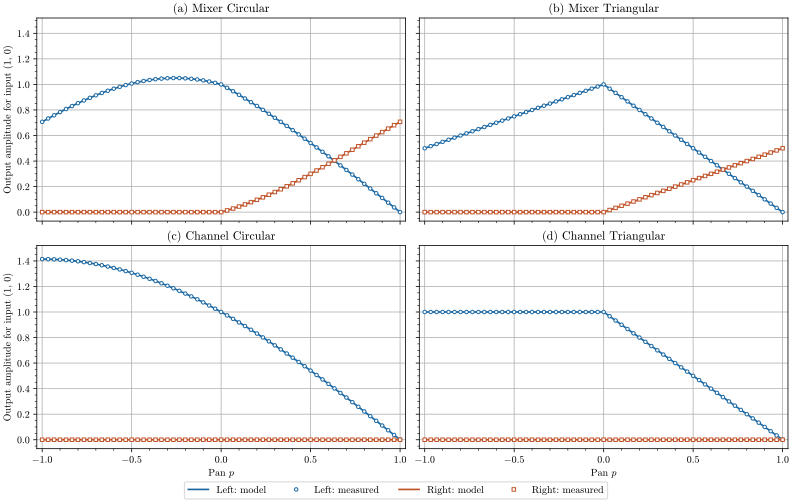
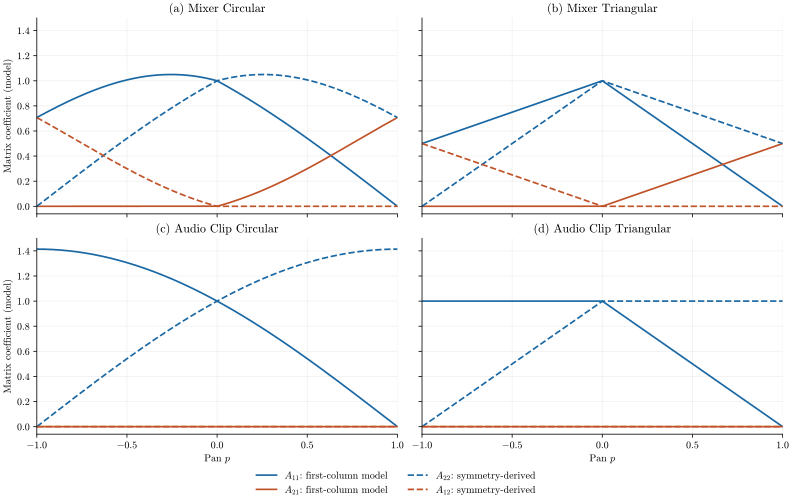
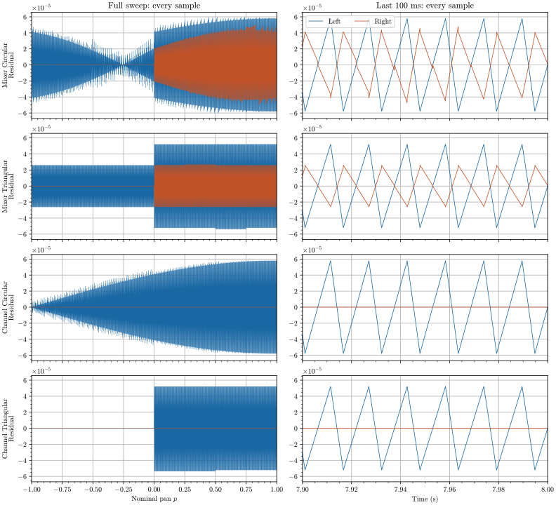
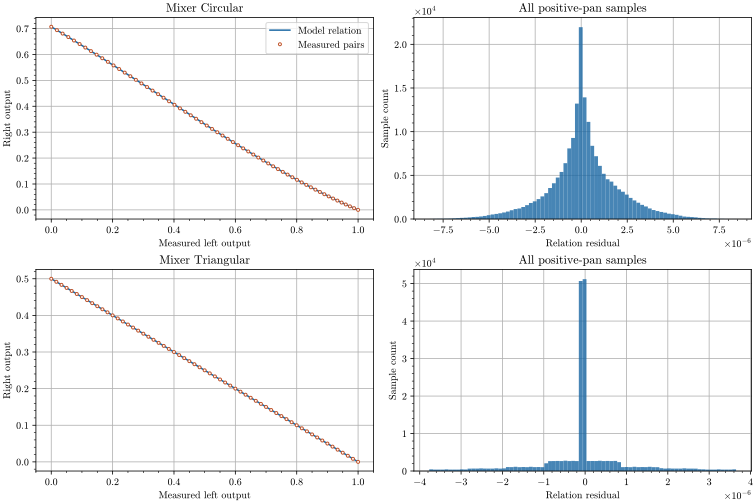
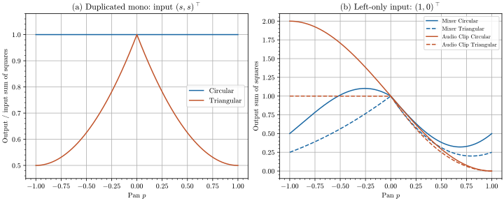
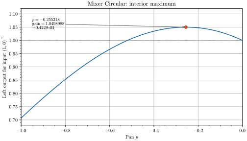

# FL Studio Panning Law

> 本文代码与实验数据见 [BiologyHazard/fl-studio-panning-law](https://github.com/BiologyHazard/fl-studio-panning-law)

## 先说结论

以下结论适用于 FL Studio 20.8.3.2304。

令 $p\in[-1,1]$ 为声像位置，$-1$、$0$、$1$ 分别表示极左、居中、极右；$x_{\text{L}},x_{\text{R}}$ 为输入音频左右声道的电平，$y_{\text{L}},y_{\text{R}}$ 为经声像变换后，输出音频左右声道的电平。声像变换由增益矩阵 $A(p)$ 表示：

$$
\begin{pmatrix}y_{\text{L}}\\y_{\text{R}}\end{pmatrix}
=A(p)\begin{pmatrix}x_{\text{L}}\\x_{\text{R}}\end{pmatrix}.
$$

工程设置中，可以设置 Panning law 为 Circular 或 Triangular，不同的 Panning law 对应不同的增益矩阵；声像应用在混音器（Mixer）上还是通道（Channel）上，规则也不同。因此，增益矩阵分为 4 种情形：Mixer × Circular、Channel × Circular、Mixer × Triangular、Channel × Triangular。下面给出 4 种情形的增益矩阵公式。

### Circular

Panning law 为 Circular 时，令 $\theta=\pi(p+1)/4$，定义辅助增益

$$
u_{\text{Circ}}(p)=\sqrt2\cos\theta,\qquad
v_{\text{Circ}}(p)=\sqrt2\sin\theta.
$$

**Mixer × Circular**

$$
A_{\text{Mixer,Circ}}(p)=
\begin{cases}
\begin{pmatrix}
u_{\text{Circ}}(1+v_{\text{Circ}})/2&
u_{\text{Circ}}(1-v_{\text{Circ}})/2\\
0&v_{\text{Circ}}
\end{pmatrix},&-1\le p\le0,\\[10pt]
\begin{pmatrix}
u_{\text{Circ}}&0\\
v_{\text{Circ}}(1-u_{\text{Circ}})/2&
v_{\text{Circ}}(1+u_{\text{Circ}})/2
\end{pmatrix},&0<p\le1.
\end{cases}
$$

**Channel × Circular**

$$
A_{\text{Channel,Circ}}(p)=
\begin{pmatrix}
u_{\text{Circ}}&0\\
0&v_{\text{Circ}}
\end{pmatrix},
\qquad -1\le p\le1.
$$

### Triangular

Panning law 为 Triangular 时，定义辅助增益

$$
u_{\text{Tri}}(p)=1-\max(p,0),\qquad
v_{\text{Tri}}(p)=1+\min(p,0).
$$

**Mixer × Triangular**

$$
A_{\text{Mixer,Tri}}(p)=
\begin{cases}
\begin{pmatrix}
1+p/2&-p/2\\
0&1+p
\end{pmatrix},&-1\le p\le0,\\[10pt]
\begin{pmatrix}
1-p&0\\
p/2&1-p/2
\end{pmatrix},&0<p\le1.
\end{cases}
$$

**Channel × Triangular**

$$
A_{\text{Channel,Tri}}(p)=
\begin{pmatrix}
u_{\text{Tri}}&0\\
0&v_{\text{Tri}}
\end{pmatrix},
\qquad -1\le p\le1.
$$

## 摘要

FL Studio 官方文档说明了 Circular 与 Triangular 的电平补偿特征及 Mixer 的声道混合行为，但未给出完整的声像变换公式。本研究以左声道单位直流信号为输入，在 FL Studio 20.8.3.2304 中对 Mixer 和 Channel 两类控制进行极左至极右的线性扫描，通过分析导出的双声道音频辨识 4 种情形的增益矩阵。结果表明，Mixer 包含向声像偏转侧的交叉混合，Channel 则分别调整左右声道增益；两种声像法则可由不同的辅助增益函数统一表示。解析公式与导出音频的逐样本最大绝对残差低于 $6.1\times10^{-5}$，消去声像参数后的 Mixer 输出关系残差低于 $8.5\times10^{-6}$。所得公式解释了同相同幅双声道输入下 Circular 的等功率性质，以及 Mixer Circular 对单侧输入产生的约 $+0.423\,\text{dB}$ 内部幅度峰值。

## 1. 引言

### 1.1 声像法则

声像旋钮看起来只是把声音移到一边，但它同时也在改变左右输出的电平。以一个单声道信号为例：声像在极左时，只有左声道输出；移到中央时，左右声道都要输出这个信号。如果两侧都保持原来的幅度，双声道总功率和合并为单声道后的电平就会发生变化。**Panning law（声像法则）规定的，正是左右声道的增益如何随声像位置变化。**

将极端位置的活动声道增益定为 $1$，对于单声道的情形，有两种典型选择：

- **保持双声道总功率：** 要求左右增益的平方和为 $1$。在中央，两侧增益各为 $1/\sqrt2$，即各比端点低约 $3\,\text{dB}$。这是常见的等功率声像法则，但将左右输出直接相加时，中央的合成幅度仍比端点高约 $3\,\text{dB}$。

- **保持单声道求和电平：** 要求左右增益之和为 $1$。在中央，两侧增益各为 $1/2$，即各比端点低约 $6\,\text{dB}$。这样，直接相加后的信号幅度不随声像变化，但中央的双声道总功率比端点低约 $3\,\text{dB}$。

这也是常见的 $-3\,\text{dB}$、$-6\,\text{dB}$ 以及折中采用的 $-4.5\,\text{dB}$ 中心衰减量的背景。它们服务于不同的电平目标，并不存在一个适用于所有场景的唯一选择。

然而，中心衰减量只描述特定一个位置，不能唯一确定从极左到极右的整条增益曲线。不同曲线可以具有相同的中心和端点增益，却在中间位置产生不同的电平变化。因此，仅知道某项设置是 “中心比端点低 $3\,\text{dB}$”，还不足以计算任意位置的输出。

对于原本就有左右两个声道的立体声输入，还多了一层问题：旋钮究竟只是分别改变左右声道的增益，还是会把一侧信号混入另一侧？前者在全偏时可能使另一侧的内容消失，后者则可能将它保留下来；发生混合时，输出电平还会受到左右信号相关性与相位关系的影响。只有单声道声像曲线不足以描述立体声的情形。

本文以 FL Studio 为例，具体考察 Mixer 与 Channel 的声像控制在 Circular 和 Triangular 设置下如何处理左右输入。需要确定的不只是一个补偿分贝数，而是整个声像范围内的同侧增益与跨声道混合关系。以下先梳理官方文档给出的描述，再明确本文的研究范围。

### 1.2 官方文档对声像法则的描述

FL Studio 官方手册在 *Project General Settings* 的 “Panning law” 条目中说明，声像法则用于补偿声音从中央移动到两侧时的表观音量变化。关于两种设置，手册给出了以下描述 [1]：

> “Circular - Level compensation is applied when panning (orange). Level drops 3 dB at center pan.”

即 Circular 在声像变化时施加电平补偿，居中位置的电平比极端位置低约 $3\,\text{dB}$。

> “Triangular - No level compensation is used as a function of pan position (green).”

即 Triangular 不随声像位置施加上述电平补偿。该条目还说明，其整体电平相对于 Circular 极端声像位置低约 $3\,\text{dB}$。

手册随后说明了音频片段在默认通道设置下的电平基准 [1]：

> “in this case volume is being added at extremes instead of subtracted at the center position.”

即在这里，补偿体现为提高两端的电平。结合该段上下文：在默认 Channel Sampler 设置下，音频片段的电平读数与录制电平相同，使用 Circular 时最多可以增加约 $3\,\text{dB}$。因此，中心与两端的相对差异，需要结合实际信号路径的电平基准理解。

关于 Mixer 的声像控制，官方 *Mixer* 页面写道 [2]：

> “The pan works by mixing one side of the stereo track into the other, so a 100% pan is the mono-sum of the Left and Right channels.”

即 Mixer 通过将一侧立体声信号混入另一侧实现声像变化，全偏时得到左右声道的单声道求和。

这些说明给出了声像控制的用途、补偿幅度及 Mixer 的混合行为，但**没有给出增益随声像位置变化的具体公式，也没有给出双声道交叉混合系数的完整表达式**。仅凭中心与端点的电平关系，仍有多种连续函数可以满足要求。因此，要确定任意声像位置下的输出，必须通过实测辨识其变换规律。

### 1.3 研究范围

本研究比较以下 4 种组合：

| 控制位置                      | Circular         | Triangular         |
| ----------------------------- | ---------------- | ------------------ |
| Mixer 的 Panning              | Mixer Circular   | Mixer Triangular   |
| Audio Clip 的 Channel panning | Channel Circular | Channel Triangular |

实验使用 FL Studio 20.8.3.2304，研究两个问题：两类声像控制如何变换左右输入，以及 Circular / Triangular 设置如何改变该变换。

**图 1. 项目声像法则设置。** “Panning law” 下拉菜单提供 Circular 和 Triangular 两个选项，构成本实验的一个控制因素。

## 2. 符号、假设与测量原理

### 2.1 输入、输出与声像参数

双声道音频由按时间排列的采样帧组成，每帧包含一个左声道样本和一个右声道样本。本文使用下列符号：

| 符号                                  | 定义                                                                                                                                                                    |
| ------------------------------------- | ----------------------------------------------------------------------------------------------------------------------------------------------------------------------- |
| $n$                                   | 从 $0$ 开始的采样帧序号，$n=0,\ldots,N-1$                                                                                                                               |
| $T$                                   | 音频的总时长，本文中 $T=8\,\text{s}$                                                                                                                                    |
| $f_s$                                 | 音频的采样率，本文中 $f_s=48000\,\text{Hz}$                                                                                                                             |
| $N = f_s \cdot T$                     | 音频的总帧数，本文中 $N=384000$                                                                                                                                         |
| $t_n=n/f_s$                           | 第 $n$ 帧对应的时间                                                                                                                                                     |
| $x_{\text{L}}[n],x_{\text{R}}[n]$     | 第 $n$ 帧输入音频的左、右声道样本值                                                                                                                                     |
| $y_{\text{L}}[n],y_{\text{R}}[n]$     | 第 $n$ 帧输出音频的左、右声道样本值                                                                                                                                     |
| $\boldsymbol{x}[n],\boldsymbol{y}[n]$ | 列向量，$\boldsymbol{x}[n]=\begin{pmatrix}x_{\text{L}}[n]\\x_{\text{R}}[n]\end{pmatrix},\boldsymbol{y}[n]=\begin{pmatrix}y_{\text{L}}[n]\\y_{\text{R}}[n]\end{pmatrix}$ |
| $p$                                   | 归一化声像位置；$-1$ 为极左，$0$ 为居中，$1$ 为极右                                                                                                                     |
| $p[n]$                                | 第 $n$ 帧的声像位置                                                                                                                                                     |
| $A(p)$                                | 声像位置为 $p$ 时的 $2\times2$ 增益矩阵                                                                                                                                 |
| $A_{ij}(p)$                           | 从输入声道 $j$ 到输出声道 $i$ 的增益                                                                                                                                    |

### 2.2 模型假设

本研究对声像变换的规则采用以下 3 个假设：

1. **无记忆性：** 在给定声像位置时，每一帧的输出仅由该帧的左右输入决定。
2. **线性性：** 在给定声像位置时，输出是输入的线性组合。
3. **左右对称性：** 同时交换输入、输出声道并反转声像方向，变换规律保持一致。

前 2 个假设使声像变换可以写成

$$
\boldsymbol{y}[n]=A(p[n])\boldsymbol{x}[n],
\qquad
A(p)=
\begin{pmatrix}
A_{\text{LL}}(p)&A_{\text{LR}}(p)\\
A_{\text{RL}}(p)&A_{\text{RR}}(p)
\end{pmatrix}.
$$

按声道展开，得到

$$
\begin{aligned}
y_{\text{L}}[n]&=A_{\text{LL}}(p[n])x_{\text{L}}[n]+A_{\text{LR}}(p[n])x_{\text{R}}[n],\\
y_{\text{R}}[n]&=A_{\text{RL}}(p[n])x_{\text{L}}[n]+A_{\text{RR}}(p[n])x_{\text{R}}[n].
\end{aligned}
$$

因此，对角元素描述同侧增益，非对角元素描述跨声道混合。线性性针对音频输入；矩阵系数随声像参数 $p$ 的变化可以是非线性的。

令交换矩阵 $J$ 为

$$
J=\begin{pmatrix}0&1\\1&0\end{pmatrix},
$$

则第 3 个假设表示为

$$
A(-p)=J A(p)J.
$$

### 2.3 左声道直流激励与矩阵重建

本实验使用恒定直流输入 $x_{\text{L}}[n]=1$、$x_{\text{R}}[n]=0$。将这一输入代入，得到

$$
y_{\text{L}}[n]=A_{\text{LL}}(p[n]),\qquad y_{\text{R}}[n]=A_{\text{RL}}(p[n]).
$$

换言之，输出样本直接读出矩阵第 1 列的两个增益系数。为表述测量结果，定义 $f(p)=A_{\text{LL}}(p)$、$h(p)=A_{\text{RL}}(p)$，分别表示左输入到左输出、左输入到右输出的增益。利用左右对称性，可重建

$$
A(p)=
\begin{pmatrix}
f(p)&h(-p)\\
h(p)&f(-p)
\end{pmatrix}.
\tag{1}
$$

因此，将同一左声道直流信号从极左扫描到极右，便可得到完整双声道变换所需的信息。

## 3. 实验设计

### 3.1 输入音频

输入为双声道直流信号：左声道在全部帧上等于 $1$，右声道在全部帧上等于 $0$。图 2 展示该信号在音频编辑器中的波形。

**图 2. 输入测试信号。** 上方左声道保持单位正幅度，下方右声道保持零。右侧刻度为 dB 显示，红色水平线为零幅度参考。

Mixer 条件对 Master 轨道的 Panning 控件施加自动化，图 3 的自动化片段标为 “Master - Panning”。Channel 条件对 Channel Rack 中的通道声像旋钮施加自动化，图 4 中标为 “Left Channel DC - Channel panning”。

**图 3. Mixer 控制位置。** 自动化目标为 Mixer 主通道的声像旋钮。

**图 4. Channel 控制位置。** 自动化目标为 Channel Rack 中 “Left Channel DC” 通道的声像旋钮。

### 3.2 渲染设置与声像扫描

| 项目           | 设置或数值                   |
| -------------- | ---------------------------- |
| 输入、输出格式 | 双声道 WAV，IEEE 754 float32 |
| 采样率 $f_s$   | 48000 Hz                     |
| 帧数 $N$       | 384000                       |
| 时长 $T=N/f_s$ | 8 s                          |
| 声像扫描       | 从极左到极右的线性自动化     |
| 实验组合       | 两类控制位置 × 两种声像法则  |
| 输出文件       | 每种组合一份，共 4 份        |

每种组合分别渲染为一份双声道音频，保留输出样本的浮点幅度，用于逐样本计算增益系数与残差。

导出时采用图 5 所示设置。选择 WAV、32Bit float 和 Stereo，以保存双声道浮点幅度；选择 Full song 并将 Tail 设为 Cut remainder，使输出长度与 8 s 扫描区间一致。

**图 5. 音频导出设置。** 导出选择 Full song 和 Cut remainder，输出为双声道 32 位浮点 WAV。

为将样本序号转换为声像坐标，定义第 $n$ 帧的**名义声像位置** $\bar p_n$：

$$
\bar p_n=-1+\frac{2t_n}{T}
=-1+\frac{2n}{N},\qquad n=0,\ldots,N-1.
$$

其中横线表示由实验时间轴指定的参数值。$n=192000$ 对应居中；最后一帧对应 $\bar p_{N-1}=1-2/N\approx0.999994792$。极右位置 $p=1$ 对应 $t=T=8\,\text{s}$，而末帧位于 $t_{N-1}=T-1/f_s$，因此音频样本不包含极右位置。

## 4. 声像法则的辨识与实测响应

本章从单位左声道输入的实测响应出发，分别辨识 4 种情形的完整变换矩阵。仍记 $f(p)$ 为左输入到左输出的增益，$h(p)$ 为左输入到右输出的增益；输入为 $(1,0)^\top$ 时，这两条曲线分别对应实测左右输出。在第 2.2 节的模型假设下，利用左右交换关系，按式 (1) 补全矩阵的另一列。

各节先给出实测波形与响应函数，再用辅助增益表示矩阵结构，随后给出仅含声像参数 $p$ 的显式形式，并说明其对左右输入的作用。Circular 的辅助增益记为 $u_{\text{Circ}}(p),v_{\text{Circ}}(p)$，Triangular 的辅助增益记为 $u_{\text{Tri}}(p),v_{\text{Tri}}(p)$；公式中可省略辅助增益的自变量 $p$。各节的 $A_{\text{LL}},A_{\text{LR}},A_{\text{RL}},A_{\text{RR}}$ 均指该节对应矩阵的元素。

### 4.1 Mixer × Circular

**图 6. Mixer Circular 的输出波形。** 左输出先升后降至 $0$，在居中之前略高于单位幅度；右输出从扫描中点之后增加，接近极右时约为 $-3\,\text{dB}$。

为描述这一响应，定义 Circular 辅助增益

$$
\theta=\frac{\pi(p+1)}4,\qquad
u_{\text{Circ}}(p)=\sqrt2\cos\theta,\qquad
v_{\text{Circ}}(p)=\sqrt2\sin\theta.
$$

其中 $\theta$ 将极左至极右的声像范围映射到 $[0,\pi/2]$。两条增益函数满足 $v_{\text{Circ}}(p)=u_{\text{Circ}}(-p)$、$u_{\text{Circ}}^2+v_{\text{Circ}}^2=2$，且在居中处均为 $1$。

对单位左输入，实测响应可用以下分段函数描述：

$$
f(p)=
\begin{cases}
u_{\text{Circ}}(1+v_{\text{Circ}})/2,&-1\le p\le0,\\
u_{\text{Circ}},&0<p\le1,
\end{cases}
\qquad
h(p)=
\begin{cases}
0,&-1\le p\le0,\\
v_{\text{Circ}}(1-u_{\text{Circ}})/2,&0<p\le1.
\end{cases}
$$

左偏区间的右输出为 $0$；右偏区间的右输出随左声道衰减而增加。将这两条函数代入左右交换关系，得到完整矩阵

$$
\begin{aligned}
A_{\text{Mixer,Circ}}(p)=
\begin{cases}
\begin{pmatrix}
u_{\text{Circ}}(1+v_{\text{Circ}})/2&
u_{\text{Circ}}(1-v_{\text{Circ}})/2\\
0&v_{\text{Circ}}
\end{pmatrix},&-1\le p\le0,\\[10pt]
\begin{pmatrix}
u_{\text{Circ}}&0\\
v_{\text{Circ}}(1-u_{\text{Circ}})/2&
v_{\text{Circ}}(1+u_{\text{Circ}})/2
\end{pmatrix},&0<p\le1.
\end{cases}
\end{aligned}
\tag{2}
$$

不使用辅助变量，写成只含 $p$ 的形式，得到

$$
A_{\text{LL}}(p)=
\begin{cases}
\frac{1}{\sqrt2}\cos\!\left(\frac{\pi(p+1)}4\right)
\left(1+\sqrt2\sin\!\left(\frac{\pi(p+1)}4\right)\right),&-1\le p\le0,\\[6pt]
\sqrt2\cos\!\left(\frac{\pi(p+1)}4\right),&0<p\le1.
\end{cases}
$$

$$
A_{\text{LR}}(p)=
\begin{cases}
\frac{1}{\sqrt2}\cos\!\left(\frac{\pi(p+1)}4\right)
\left(1-\sqrt2\sin\!\left(\frac{\pi(p+1)}4\right)\right),&-1\le p\le0,\\[6pt]
0,&0<p\le1.
\end{cases}
$$

$$
A_{\text{RL}}(p)=
\begin{cases}
0,&-1\le p\le0,\\[6pt]
\frac{1}{\sqrt2}\sin\!\left(\frac{\pi(p+1)}4\right)
\left(1-\sqrt2\cos\!\left(\frac{\pi(p+1)}4\right)\right),&0<p\le1.
\end{cases}
$$

$$
A_{\text{RR}}(p)=
\begin{cases}
\sqrt2\sin\!\left(\frac{\pi(p+1)}4\right),&-1\le p\le0,\\[6pt]
\frac{1}{\sqrt2}\sin\!\left(\frac{\pi(p+1)}4\right)
\left(1+\sqrt2\cos\!\left(\frac{\pi(p+1)}4\right)\right),&0<p\le1.
\end{cases}
$$

这 4 个系数同时描述同侧增益与交叉混合。为看清混合比例，以左偏区间为例，将输出写成

$$
y_{\text{L}}=
u_{\text{Circ}}\left(
\frac{1+v_{\text{Circ}}}{2}x_{\text{L}}
+\frac{1-v_{\text{Circ}}}{2}x_{\text{R}}
\right),\qquad
y_{\text{R}}=v_{\text{Circ}}x_{\text{R}}.
$$

左输出括号内的两项权重之和为 $1$：居中时 $v_{\text{Circ}}=1$，权重为 $(1,0)$；极左时 $v_{\text{Circ}}=0$，权重为 $(1/2,1/2)$。与此同时，外部增益 $u_{\text{Circ}}$ 从 $1$ 增至 $\sqrt2$。因此，偏转过程同时改变左右输入的混合比例及混合后的增益。对于本实验的单侧输入，这两种变化共同产生左偏区间的内部幅度峰值，其位置与幅度在第 6.3 节求得。

### 4.2 Mixer × Triangular

**图 7. Mixer Triangular 的输出波形。** 左输出从约 $-6\,\text{dB}$ 线性增加至居中的 $0\,\text{dB}$，再线性下降至 $0$；右输出在左偏区间为 $0$，在右偏区间线性增加至约 $-6\,\text{dB}$。

Triangular 的辅助增益为

$$
u_{\text{Tri}}(p)=1-\max(p,0),\qquad
v_{\text{Tri}}(p)=1+\min(p,0).
$$

左偏时 $u_{\text{Tri}}=1$、$v_{\text{Tri}}=1+p$；右偏时 $u_{\text{Tri}}=1-p$、$v_{\text{Tri}}=1$。对单位左输入，实测响应对应

$$
f(p)=
\begin{cases}
1+p/2,&-1\le p\le0,\\
1-p,&0<p\le1,
\end{cases}
\qquad
h(p)=
\begin{cases}
0,&-1\le p\le0,\\
p/2,&0<p\le1.
\end{cases}
$$

将上述表达式写成辅助增益形式并补全矩阵，得到

$$
\begin{aligned}
A_{\text{Mixer,Tri}}(p)&=
\begin{cases}
\begin{pmatrix}
u_{\text{Tri}}(1+v_{\text{Tri}})/2&
u_{\text{Tri}}(1-v_{\text{Tri}})/2\\
0&v_{\text{Tri}}
\end{pmatrix},&-1\le p\le0,\\[10pt]
\begin{pmatrix}
u_{\text{Tri}}&0\\
v_{\text{Tri}}(1-u_{\text{Tri}})/2&
v_{\text{Tri}}(1+u_{\text{Tri}})/2
\end{pmatrix},&0<p\le1.
\end{cases}\\[12pt]
&=
\begin{cases}
\begin{pmatrix}
1+p/2&-p/2\\
0&1+p
\end{pmatrix},&-1\le p\le0,\\[10pt]
\begin{pmatrix}
1-p&0\\
p/2&1-p/2
\end{pmatrix},&0<p\le1.
\end{cases}
\end{aligned} \tag{3}
$$

式 (3) 与 Mixer Circular 具有相同的混合结构，但所有系数均为分段线性函数。对单位左输入，左输出在左偏区间从极左的 $1/2$ 增至居中的 $1$；右偏时，左输出降至零，右输出增至 $1/2$。对一般双声道输入，左偏时右输入通过 $-p/2$ 混入左输出，右偏时左输入通过 $p/2$ 混入右输出。两端的活动声道均输出 $(x_{\text{L}}+x_{\text{R}})/2$，与 Circular 的端点增益不同。

### 4.3 Channel × Circular

**图 8. Channel Circular 的输出波形。** 左输出从约 $+3\,\text{dB}$ 逐渐下降至 $0$，右输出始终为 $0$。

采用第 4.1 节定义的 Circular 辅助增益。本实验中，右输出在全部帧上均为数值零，左输出与 $u_{\text{Circ}}(p)$ 对应。因此，左声道激励辨识得到的两条响应为

$$
f(p)=u_{\text{Circ}}(p),\qquad h(p)=0.
$$

由 $u_{\text{Circ}}(-p)=v_{\text{Circ}}(p)$，完整矩阵为

$$
\begin{aligned}
A_{\text{Channel,Circ}}(p)&=
\begin{pmatrix}
u_{\text{Circ}}&0\\
0&v_{\text{Circ}}
\end{pmatrix}\\[12pt]
&=
\begin{pmatrix}
\sqrt2\cos\!\left(\frac{\pi(p+1)}4\right)&0\\[6pt]
0&\sqrt2\sin\!\left(\frac{\pi(p+1)}4\right)
\end{pmatrix},
\qquad -1\le p\le1.
\end{aligned} \tag{4}
$$

矩阵为对角形式，即 $y_{\text{L}}=u_{\text{Circ}}x_{\text{L}}$、$y_{\text{R}}=v_{\text{Circ}}x_{\text{R}}$，左右输入分别调整增益，不发生交叉混合。左声道输入在极左处获得 $\sqrt2$ 倍增益，在居中处获得单位增益，在极右处降为零；右声道的变化与之镜像对称。与 Mixer Circular 相比，Channel 的同侧增益直接采用 Circular 辅助增益，因而本实验中的左输入始终只出现在左输出。

### 4.4 Channel × Triangular

**图 9. Channel Triangular 的输出波形。** 左输出在左偏区间保持 $0\,\text{dB}$，后半段线性下降到 $0$；右输出始终为 $0$。

采用第 4.2 节定义的 Triangular 辅助增益。实测左输出在左半区保持单位幅度，在右半区线性下降；右输出在全部帧上均为数值零。因此，左声道激励辨识得到的两条响应为

$$
f(p)=u_{\text{Tri}}(p),\qquad h(p)=0.
$$

利用 $u_{\text{Tri}}(-p)=v_{\text{Tri}}(p)$，得到

$$
\begin{aligned}
A_{\text{Channel,Tri}}(p)&=
\begin{pmatrix}
u_{\text{Tri}}&0\\
0&v_{\text{Tri}}
\end{pmatrix}\\[12pt]
&=
\begin{cases}
\begin{pmatrix}
1&0\\
0&1+p
\end{pmatrix},&-1\le p\le0,\\[10pt]
\begin{pmatrix}
1-p&0\\
0&1
\end{pmatrix},&0<p\le1.
\end{cases}
\end{aligned} \tag{5}
$$

因此，左偏时输出为 $y_{\text{L}}=x_{\text{L}}$、$y_{\text{R}}=(1+p)x_{\text{R}}$；右偏时输出为 $y_{\text{L}}=(1-p)x_{\text{L}}$、$y_{\text{R}}=x_{\text{R}}$。偏转侧保持单位增益，另一侧随声像位置线性衰减。与 Channel Circular 相比，对角矩阵结构不变，但三角函数增益被分段线性增益取代；与 Mixer Triangular 相比，则没有将另一侧输入混入偏转侧的交叉项。

### 4.5 响应对比与结构总结

以上各节给出了同一变换的两种写法：辅助增益形式便于比较结构，仅含 $p$ 的显式形式便于直接计算。式 (2)、(3) 具有相同的分段混合结构，式 (4)、(5) 具有相同的对角结构；Circular 与 Triangular 则分别采用三角函数和分段线性增益。下面将这两方面的差异与实测响应一起比较。

**图 10. 单位左声道输入的输出响应。** 蓝色和橙色分别表示左、右输出；实线为式 (2)—(5) 的计算结果，空心符号为均匀选取的实测样本。横坐标为名义声像位置。原始输出波形见图 6 ~ 9。

两份 Channel 输出的右声道在全部帧上均为数值零；两份 Mixer 输出的右声道在右半段出现信号。两类控制的核心区别是：**Channel 分别调整两侧增益，Mixer 将另一侧输入混入声像偏转侧。**

**图 11. 完整矩阵的 4 个系数。** 实线为通过左声道激励辨识的第一列，虚线为按式 (1) 补全的第二列。蓝色表示同侧增益，橙色表示交叉混合增益；部分零系数曲线重合。

4 种情形均在居中处满足 $A(0)=I$，其中 $I$ 为 $2\times2$ 单位矩阵，因此居中时输出逐声道等于输入。上述曲线展示了公式与实测响应的整体对应关系；下一章进一步通过逐样本残差与消参关系检验量化二者的差异。

## 5. 误差分析

### 5.1 全范围逐样本残差

原始 float32 样本转换为 float64 后用于计算。对输出声道 $c$（$c=\text{L}$ 或 $\text{R}$），记 $\hat y_c(p)$ 为单位左声道输入时公式预测的输出，定义残差

$$
e_c[n]=y_c[n]-\hat y_c(\bar p_n).
$$

使用最大绝对残差 $E_{\infty,c}$ 和残差均方根 $E_{\text{RMS},c}$ 衡量一致性：

$$
E_{\infty,c}=\max_n|e_c[n]|,\qquad
E_{\text{RMS},c}=
\sqrt{\frac1N\sum_{n=0}^{N-1}e_c[n]^2}.
$$

全部 $384000$ 帧均参与统计，幅度以输入的单位幅度为参考。

逐样本统计结果见表 1。

**表 1. 4 种声像法则的前向残差。**

| 条件               |   左输出最大绝对残差 |           左输出 RMS |   右输出最大绝对残差 |           右输出 RMS |
| ------------------ | -------------------: | -------------------: | -------------------: | -------------------: |
| Mixer Circular     | $6.074\times10^{-5}$ | $2.369\times10^{-5}$ | $5.030\times10^{-5}$ | $1.533\times10^{-5}$ |
| Mixer Triangular   | $5.360\times10^{-5}$ | $2.345\times10^{-5}$ | $2.677\times10^{-5}$ | $1.051\times10^{-5}$ |
| Channel Circular   | $5.826\times10^{-5}$ | $2.372\times10^{-5}$ |                  $0$ |                  $0$ |
| Channel Triangular | $5.363\times10^{-5}$ | $2.122\times10^{-5}$ |                  $0$ |                  $0$ |

**图 12. 实测值减去公式预测值的逐样本残差 $e_c[n]$。** 左列直接绘制全声像范围内全部 $384000$ 帧的残差；右列显示末尾 100 ms（$7.9\le t<8.0\,\text{s}$）的全部 4800 帧。两列均保留残差的正负号，以逐样本残差连线绘制，不取绝对值、不分箱、不取包络，也不抽样。所有子图使用相同的纵轴范围，便于直接比较残差幅度；轴旁的科学计数因子表示刻度量级。右列展示残差的局部时间结构。

### 5.2 消去声像参数的输出关系检验

对于 Mixer 的右偏区间，可以消去 $p$，直接检验同一帧左右输出之间的关系。这样，公式的检验只需使用输出幅度。

对 Mixer Circular，式 (2) 给出

$$
\hat y_{\text{R}}=
\frac{(1-y_{\text{L}})\sqrt{2-y_{\text{L}}^2}}2.
$$

对 Mixer Triangular，式 (3) 给出

$$
\hat y_{\text{R}}=\frac{1-y_{\text{L}}}{2}.
$$

这里 $y_{\text{L}}$ 是同一帧的实测左输出，$\hat y_{\text{R}}$ 是由该左输出预测的右输出。令关系残差 $r=y_{\text{R}}-\hat y_{\text{R}}$，在全部名义 $p>0$ 的 $191999$ 帧上得到：

**表 2. Mixer 左右输出关系的残差。**

| 条件             |         最大绝对残差 |                  RMS |
| ---------------- | -------------------: | -------------------: |
| Mixer Circular   | $8.411\times10^{-6}$ | $1.906\times10^{-6}$ |
| Mixer Triangular | $3.770\times10^{-6}$ | $1.064\times10^{-6}$ |

**图 13. 消去声像参数后的输出关系。** 左列实线为上述两种消参关系，空心符号为实测输出；右列直方图包含所有右偏样本的关系残差。

float32 在 $[1,2)$ 区间的相邻数间距为 $2^{-23}\approx1.192\times10^{-7}$，在 $[0.5,1)$ 区间为 $2^{-24}\approx5.960\times10^{-8}$。表 1 的残差高于单位幅度附近单次存储舍入的量级，反映的是扫描轨迹与整个处理过程的综合差异。

## 6. 声像变换的性质

### 6.1 极端声像处的输出

令 $k$ 表示端点增益常数：Circular 对应 $k=\sqrt2$，Triangular 对应 $k=1$。4 种情形在端点可归纳为

$$
A_{\text{Mixer}}(-1)=\frac{k}{2}
\begin{pmatrix}1&1\\0&0\end{pmatrix},
\qquad
A_{\text{Mixer}}(1)=\frac{k}{2}
\begin{pmatrix}0&0\\1&1\end{pmatrix},
\tag{6}
$$

$$
A_{\text{Channel}}(-1)=
\begin{pmatrix}k&0\\0&0\end{pmatrix},
\qquad
A_{\text{Channel}}(1)=
\begin{pmatrix}0&0\\0&k\end{pmatrix}.
$$

因此，Mixer 全偏时，偏转侧输出为左右输入的加权和：Circular 为 $(x_{\text{L}}+x_{\text{R}})/\sqrt2$，Triangular 为 $(x_{\text{L}}+x_{\text{R}})/2$。这给出了官方 “mono-sum” 描述中的具体比例系数。Channel 全偏时，偏转侧输出为该侧原输入的 $k$ 倍。

对于左右反相输入 $(s,-s)^\top$，其中 $s$ 为任意瞬时样本值，Mixer 全偏时两侧输入在求和中抵消；Channel 则保留偏转侧的输入分量。

**表 3. 单位左输入的模型端点与实测边界样本。**

| 条件               | 公式在 $p=-1$ 的输出 $(y_{\text{L}},y_{\text{R}})$ | 实测首帧          | 公式在 $p=1$ 的输出 $(y_{\text{L}},y_{\text{R}})$ | 实测末帧                              |
| ------------------ | -------------------------------------------------- | ----------------- | ------------------------------------------------- | ------------------------------------- |
| Mixer Circular     | $(0.707106781,0)$                                  | $(0.707106709,0)$ | $(0,0.707106781)$                                 | $(5.556781\times10^{-6},0.707104146)$ |
| Mixer Triangular   | $(0.5,0)$                                          | $(0.499999881,0)$ | $(0,0.5)$                                         | $(4.999208\times10^{-6},0.499998212)$ |
| Channel Circular   | $(1.414213562,0)$                                  | $(1.414212704,0)$ | $(0,0)$                                           | $(5.554710\times10^{-6},0)$           |
| Channel Triangular | $(1,0)$                                            | $(0.999999821,0)$ | $(0,0)$                                           | $(5.000166\times10^{-6},0)$           |

末帧的名义位置为 $1-2/N$；表中分别列出理论端点与采样边界，便于比较。

### 6.2 同相双声道输入的功率关系

对于左右相同的输入 $\boldsymbol{x}=(s,s)^\top$，两类声像控制在相同声像法则下得到相同输出。Circular 为

$$
\boldsymbol{y}=
\begin{pmatrix}
\sqrt2\cos\!\left(\dfrac{\pi(p+1)}4\right)s\\[4pt]
\sqrt2\sin\!\left(\dfrac{\pi(p+1)}4\right)s
\end{pmatrix};
$$

Triangular 为

$$
\boldsymbol{y}=
\begin{cases}
\begin{pmatrix}s\\(1+p)s\end{pmatrix},&-1\le p\le0,\\[6pt]
\begin{pmatrix}(1-p)s\\s\end{pmatrix},&0<p\le1.
\end{cases}
$$

定义输入、输出的瞬时双声道平方和分别为 $Q_x=x_{\text{L}}^2+x_{\text{R}}^2$、$Q_y=y_{\text{L}}^2+y_{\text{R}}^2$。对这些平方量作时间平均即得到相应数字信号的均方功率。Circular 满足

$$
Q_y=2s^2=Q_x,
$$

即对同相同幅双声道输入保持功率。Triangular 对应

$$
\frac{Q_y}{Q_x}=
\frac{1+(1-|p|)^2}{2},\qquad s\ne0,
\tag{7}
$$

从居中时的 $1$ 降至端点的 $1/2$。

对单侧输入 $(1,0)^\top$，输出平方和为 $f(p)^2+h(p)^2$，随声像位置变化，如图 14(b)。对于一般双声道输入，Mixer 的交叉混合还使输出功率依赖左右输入的相关性。

**图 14. 由声像公式计算的功率关系。** (a) 同相同幅双声道输入的输出／输入平方和之比；(b) 单位左输入的输出平方和。

### 6.3 Mixer Circular 的内部幅度峰值

对单位左输入，在 $p\in[-1,0]$ 区间定义角变量 $\theta=\pi(p+1)/4$，因此 $\theta\in[0,\pi/4]$。由式 (2)，左输出可写为

$$
f(\theta)=\frac{\sqrt2\cos\theta+\sin2\theta}{2}.
$$

对 $\theta$ 求导，驻点满足

$$
\frac{\mathrm{d}f}{\mathrm{d}\theta}=0
\iff 2\cos2\theta=\sqrt2\sin\theta
\iff 4\sin^2\theta+\sqrt2\sin\theta-2=0.
$$

记极大值处的角变量和声像位置分别为 $\theta_*$、$p_*$，则

$$
\sin\theta_*=\frac{\sqrt{34}-\sqrt2}{8},
\qquad
p_*=\frac4\pi\arcsin\!\left(\frac{\sqrt{34}-\sqrt2}{8}\right)-1
\approx-0.255318408.
$$

该点二阶导数为负；结合两端值可得最大幅度

$$
f_{\max}=\frac{\sqrt{142+34\sqrt{17}}}{16}
\approx1.049898788,
\qquad
20\log_{10}f_{\max}\approx0.422949\,\text{dB}.
$$

实测 Mixer Circular 左输出最大值为 $1.049898863$，与解析峰值相差约 $7.443\times10^{-8}$。该峰值位于极左与居中之间，构成这一组合的局部电平凸起。

Channel Circular 的最大左声道增益位于极左端点，为 $\sqrt2$，对应 $+3.010300\,\text{dB}$，与官方所述端点约增加 $3\,\text{dB}$ 一致。浮点音频可以保存这些超过单位幅度的样本；最终输出的削波情况取决于后续处理和编码范围。

**图 15. Mixer Circular 的内部幅度峰值。** 曲线为单位左输入时左输出的幅度，标记点表示左偏区间的幅度极大值。

## 7. 结论

本实验得到了 FL Studio 20.8.3.2304 在 4 种情形下的声像规则。Mixer Circular、Mixer Triangular、Channel Circular 和 Channel Triangular 的完整变换分别由式 (2) ~ (5) 给出。

两类控制的结构区别在于交叉混合：Channel 分别改变两声道增益；Mixer 将另一侧信号混入偏转侧，并在极端声像处形成加权单声道和。Circular 与 Triangular 分别采用三角函数和分段线性系数。它们在居中处均保持输入，在同相同幅双声道输入下表现出相同控制位置间的等价性。

逐样本比较与消参关系检验共同支持上述公式：全范围前向最大绝对残差低于 $6.1\times10^{-5}$，Mixer 输出关系最大绝对残差低于 $8.5\times10^{-6}$。公式进一步解释了 Circular 的功率补偿、Mixer 在全偏时的求和比例，以及 Mixer Circular 单侧输入响应中的 $+0.423\,\text{dB}$ 内部峰值，补全了官方定性说明所缺少的具体变换关系。

## 8. 从实验辨识到实现验证

本研究通过分析 FL Studio 导出的音频，推测声像变换的解析公式，并以输出残差检验公式与实验结果的一致性。这种方法给出了输入与输出之间的定量关系；进一步确认公式与软件实际实现的对应关系，需要考察内部处理代码。

后续研究可通过反汇编定位声像处理及自动化参数更新的相关函数，从代码实现层面寻找证据。将汇编分析得到的处理流程与实验公式逐项比较，并按照实际运算顺序和数值精度复现计算，有望解释残差的具体来源。若复现结果能够同时重现输出曲线与残差结构，就可以将本文的实验推断与软件实现联系起来，为声像法则及其误差机制提供更直接的证据。

## 参考文献

[1] Image-Line. *FL Studio Online Manual: Project General Settings*, “Panning law”. [官方页面](https://www.image-line.com/fl-studio-learning/fl-studio-online-manual/html/songsettings_settings.htm#Panning_Law). 查阅日期：2026-10-25。

[2] Image-Line. *FL Studio Online Manual: Mixer*, “Panning”. [官方页面](https://www.image-line.com/fl-studio-learning/fl-studio-online-manual/html/mixer.htm). 查阅日期：2026-10-25。

[3] BiologyHazard. *FL Studio Panning Law*. [代码仓库](https://github.com/BiologyHazard/fl-studio-panning-law).
